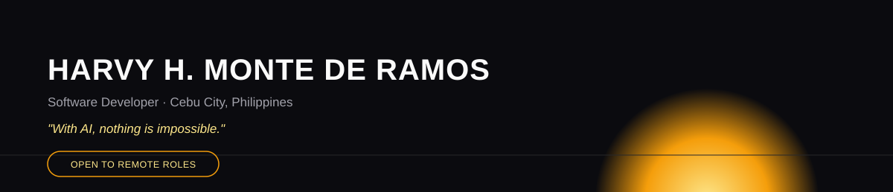
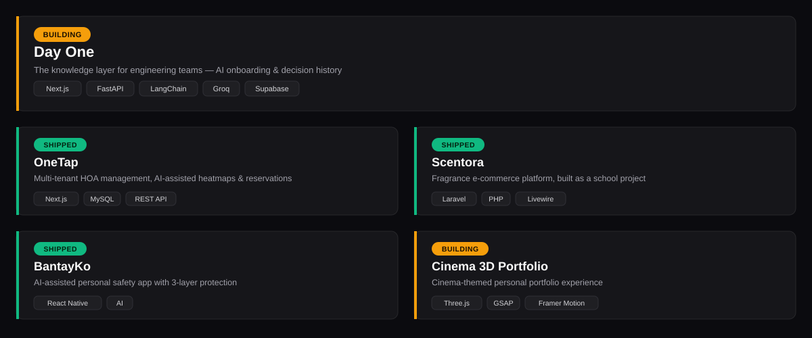

  

  
  
  

  

## Featured projects

  
  
  

  Code: <a href="https://github.com/gghrvy/Prospectos">ProspectOS</a> · <a href="https://github.com/gghrvy/Clippilot">Clippilot</a> · <a href="https://github.com/gghrvy/Dev-Day-One">Day One</a>

## Stack

  

## Background

  

<b>Open to remote roles worldwide.</b> Based in Cebu City, Philippines (UTC+8).

  

 

Software developer building full-stack web applications and AI-integrated tools. Background in AIoT systems. Currently building a B2B platform from scratch.

## Stack

  

## Projects

| Project | What it does | Stack | Live |
|---|---|---|---|
| [ProspectOS](https://github.com/gghrvy/Prospectos) | Finds local businesses, audits their sites with Playwright, scores each lead and drafts outreach for human review | Next.js, FastAPI, Postgres | [Demo](https://prospectos-blond.vercel.app/prospects) |
| [Clippilot](https://github.com/gghrvy/Clippilot) | Turns long videos into captioned vertical clips with AI ranking, a clip editor and a background worker | Python, faster-whisper, Groq/Ollama, FFmpeg, React | [Demo](https://clippilot-bice.vercel.app) |
| [Day One](https://github.com/gghrvy/Dev-Day-One) | Chat with your codebase: RAG over GitHub repos, architecture graphs, ADRs | Next.js, FastAPI, Supabase pgvector, Groq | [Demo](https://devdayone.vercel.app) |

  

## Background

  

| | |
|---|---|
|  | [harvyh.montederamos@gmail.com](mailto:harvyh.montederamos@gmail.com) |
|  | [+63 919 065 2138](tel:+639190652138) |
|  | [linkedin.com/in/harvy-montederamos](https://linkedin.com/in/harvy-montederamos) |
|  | [github.com/gghrvy](https://github.com/gghrvy) |

**Open to remote roles worldwide.**

