  

  
  
  

  

## Featured projects

  
  
  

  Code: <a href="https://github.com/gghrvy/Prospectos">ProspectOS</a> · <a href="https://github.com/gghrvy/Clippilot">Clippilot</a> · <a href="https://github.com/gghrvy/Dev-Day-One">Day One</a>

## Stack

  

## Background

  

<b>Open to remote roles worldwide.</b> Based in Cebu City, Philippines (UTC+8).

